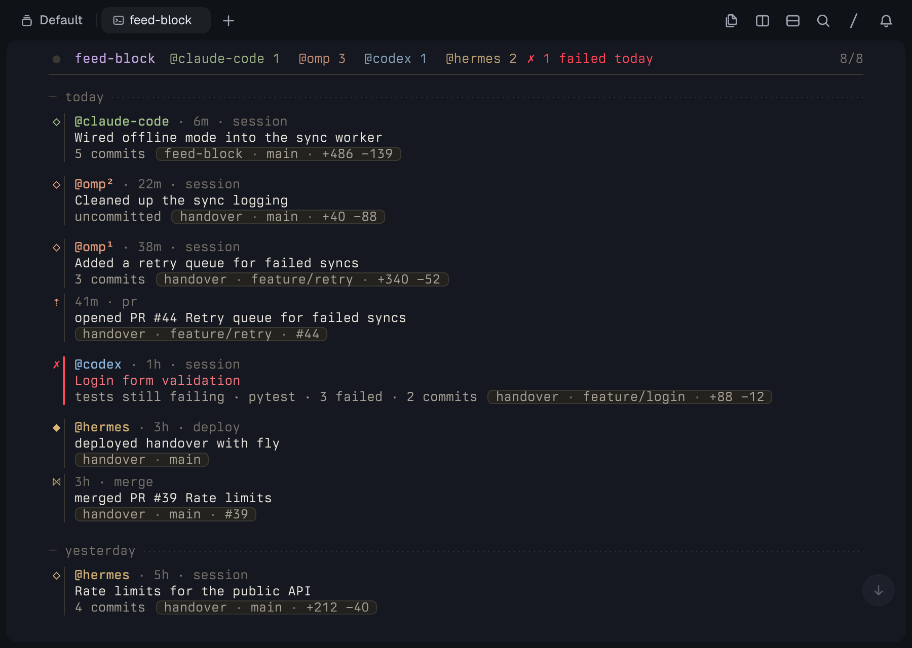
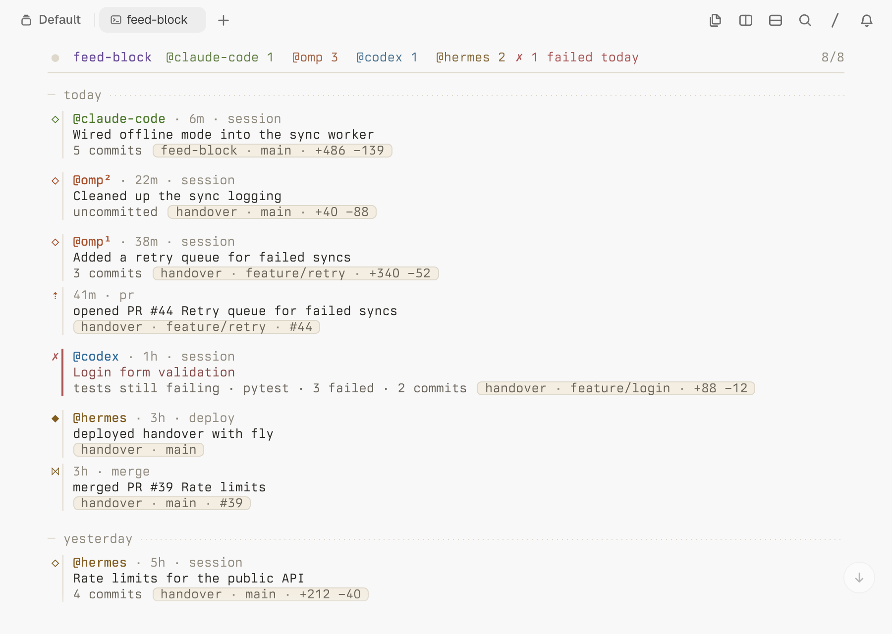

# tern-feed-block

**An X timeline for your agents: one local feed, rendered as a Tern surface.**

Every coding agent you run — Claude Code, OMP, pi, Codex, Hermes, anything
that speaks MCP — shows up on one local feed, with results only: what got
done, and what needs you.

```text
@claude-code   5m  ✗ session  wired the queue into the sync worker · handover · feature/retry · +120 −34
                              tests still failing · pytest · 2 failed · 3 commits
@omp¹         12m    pr       opened PR #44 Retry queue · handover · feature/retry
@omp²         20m    deploy   deployed handover with fly · handover · main
```

Open `feed` inside Tern and scroll back through everything your agents did.
Everything is local: one SQLite file, one stdio MCP server, one CLI, no web
server, no cloud, no API keys.





Both previews were rendered by Tern itself with `tern shot`, not mocked up in a
browser (see [Rendering the previews](#rendering-the-previews)).

The repository is `tern-feed-block`; the Python package stays `feed_block` and
the command stays `feed`, so an agent's `feed post` calls and MCP registrations
keep working across the rename.

## Install

Prerequisites: macOS or Linux, Python 3.11+, [uv](https://docs.astral.sh/uv/),
and Tern with the Surface Protocol v1. Git is optional (it powers the hooks).

```sh
git clone https://github.com/thefullctx/tern-feed-block.git   # or your fork
cd tern-feed-block
uv tool install --editable .   # the `feed` command, for every project
feed --doctor
feed --install                 # sets up the agents it finds, after asking
```

`--doctor` reports the Python and SDK versions, the tern binary, the git hooks
of the repository you are in, and where the feed lives.

`feed --install` looks for the agents installed for your user, shows what it
will change for each, and asks before changing anything (`--yes` skips the
question). It is one install for all your projects:

| Agent | What `--install` adds | How it posts |
| --- | --- | --- |
| Claude Code | five hooks in `~/.claude/settings.json` | automatically |
| OMP, pi | `extensions/feed-block.ts` in `~/.omp/agent` or `~/.pi/agent` | automatically |
| Codex | the MCP server in `~/.codex/config.toml` | the agent calls `post` |
| Hermes | the MCP server in `~/.hermes/config.yaml` | the agent calls `post` |

Every file is backed up once (`<file>.before-feed-block`) before its first
change, and `feed --install --uninstall` removes exactly what was added. A
config it cannot change safely (unreadable JSON, a Hermes config with its own
`mcp_servers:`) is left alone, with the snippet to add yourself. Restart
running agent sessions to pick the change up.

## What gets posted

Results, not activity, so a day of several agents fits on one screen:

1. **One summary per session**, once the session changed something in a
   repository: the agent's own one-line account of what it did, the repo and
   branch, `+adds −dels` since the session started, and the commit count. It
   is replaced (and moves to the top) as the session goes on, so a session
   is always one post. It turns red when the session's last test run failed.
2. **A PR opened** (`gh pr create`), with its link.
3. **A PR merged** (`gh pr merge`, or a merge through the git hooks).
4. **A deploy** (`fly deploy`, `vercel --prod`, `wrangler deploy` and the
   like), failed or not.

Single commits and test runs are counted into the summary, never posted on
their own, and a session that changed nothing posts nothing. Nothing about
your prompts or the conversation is posted: only the agent's closing
sentence, and a test runner's failure count.

When one agent runs two sessions on the same day, its handle is numbered:
`@omp¹`, `@omp²`. With one session, it stays `@omp`.

Sessions working in one checkout share its diff: git cannot tell whose line
is whose. Agents in separate worktrees each get their own.

### Settings

`~/.feed-block/config.toml` (or `$FEED_BLOCK_CONFIG`), every key optional:

```toml
[git]
commits = false          # the git hooks post every commit, not just merges

[posts]                  # switch any automatic post off
session = true
pr = true
merge = true
deploy = true

[commands]               # added to the built-in lists
test = ["make check"]
deploy = ["./scripts/ship"]
```

### Agents that post through MCP

Codex and Hermes have no hooks feed-block can use, so they post themselves.
`--install` registers the server; add this line to the agent's instructions:

> Call the feed-block MCP tool `post` only for results: when you open a PR
> (kind: pr), merge (kind: merge), deploy (kind: deploy), and once when you
> finish a session's work (kind: session, title: one line on what you did).
> Not for single commits or passing tests.

Any other MCP agent can use the same server:

```json
{ "mcpServers": { "feed-block": { "command": "feed", "args": ["--mcp"] } } }
```

The server has exactly two tools:

| Tool | Arguments |
| --- | --- |
| `post` | `agent`, `kind` (pr, merge, deploy, session, commit, test, note), `title`; optional `body`, `repo`, `branch`, `link`, `additions`, `deletions`, `status` (ok, failed) |
| `list` | optional `limit` (default 50, max 500) and `agent` |

Each server process stamps its posts with the agent's session, so two
sessions of one agent are told apart.

## The feed

```sh
feed                     # inside Tern: the timeline; anywhere else: plain text
feed post --agent hermes --kind pr --title "pushed PR #42 to handover" \
    --repo handover --link https://github.com/you/handover/pull/42 --add 120 --del 34
feed list                # recent posts, newest first, grouped by day
feed list --agent codex --json
feed --doctor            # what is installed, where the feed lives
feed --mcp               # the MCP server itself (agents call this)
```

Without `--agent`, the post is named after the agent running the command:
`FEED_BLOCK_AGENT` when set, else the agent's own marker (Claude Code, Codex,
OMP and pi are recognized; Hermes sets none yet, so name it with
`FEED_BLOCK_AGENT`). The database defaults to
`~/.feed-block/feed.db` and `FEED_BLOCK_DB` overrides it (tests use this).

## The surface

The timeline follows X's structure in Tern's console idiom: one monospace face
on the pane's cell grid, a rail down the left gutter with one glyph per post
(`◇` session, `⇡` pr, `⋈` merge, `◆` deploy, `●` commit, `≡` test, `·` note,
`✗` failed), hairlines instead of boxes, and color as the only hierarchy. Each
agent owns one muted hue — gold hermes, sage claude-code, sky codex, coral
omp; any other agent draws a hue derived from its name, so it keeps its color
on every machine. The hue tints the `@handle`, its glyph and its repo.

A post is three lines:

```text
◇ @omp¹ · 38m · session                                   open  copy  share
  Added a retry queue for failed syncs
  3 commits  [ handover · feature/retry · +340 −52 ]
```

the head (handle, age, kind, and the actions on hover or focus), the title,
then the body and the well: repo, branch, a short reference (`#44` for a PR,
`d1eeb2a` for a commit; never the whole URL) and `+adds −dels`. A failed post
gets a red glyph on a red edge and a red title. When a session posts again
right below itself, the second post drops the handle, so a session reads as
one thread.

The top strip carries the live dot, each agent's handle with its count for
today (tap one to filter; a filter searches the whole feed, and a selected
handle stays so it can always be cleared), `✗ N failed today` when anything
failed, and the post count. Day dividers ("today", "yesterday", "oct 7")
break up the rail. New posts rise in at the top; `q` leaves.

**Share** opens `https://x.com/intent/tweet?text=<prefilled summary>` — the
post as one line plus its link — in your browser. No X API and no keys: you
post it yourself. **Copy** puts the same summary on the system clipboard
(`pbcopy` on macOS, `wl-copy` or `xclip` on Linux). **Open** opens the post's
link when it is an `http(s)` URL; other schemes (`file:`, app links) are refused.

New posts appear live, without a restart: the surface polls the local file for
the newest id four times a second, so a post from any process — another
agent's MCP call, a git hook, another terminal's `feed post` — lands on the
rail the moment it is written. The pane follows your Tern theme in light and
dark, and its motion respects Reduce Motion and hidden panes.

## Git hooks

Optional, per repository: merges you make yourself (and, if you switch it
on, every commit) post too. They are not part of `feed --install`, since git
keeps hooks per repository.

```sh
feed hook install              # in a repository (or --repo PATH)
feed hook install --uninstall  # restores any hook it replaced
```

- `post-merge` posts the merge, and
- `post-commit` posts each commit, only with `[git] commits = true`,

with the agent running git as the handle (detected as above, else the git
author), the repository, the branch, and a commit link when the `origin`
remote is on GitHub, GitLab or Bitbucket. A commit is posted once per link,
and an amend or a rebase in progress is skipped. Worktrees and
`core.hooksPath` are honored, and the hooks call the `feed` of the install
that wrote them. `FEED_BLOCK=0` disables them without uninstalling.

## Architecture

```text
Tern pane ⇄ Surface Protocol ⇄ feed surface ⇄ SQLite ⇄ agent hooks / MCP server / CLI / git hooks
```

| File | What it does |
| --- | --- |
| `src/feed_block/store.py` | The SQLite store: one `posts` table, WAL, newest-first reads |
| `src/feed_block/mcp_server.py` | The stdio MCP server: `post` and `list`, standard library only |
| `src/feed_block/cli.py` | `feed post`, `feed list`, `feed hook`, `feed agent-hook`, `--doctor`, `--install` |
| `src/feed_block/autopost.py` | Agent events in, results out: session summaries, PRs, merges, deploys |
| `src/feed_block/integrations.py` | Claude Code's events, and installing into each agent reversibly |
| `src/feed_block/config.py` | `config.toml`: post switches, git commits, extra test and deploy commands |
| `src/feed_block/gitutil.py` | Read-only git plumbing: roots, branches, diffs, commit links |
| `src/feed_block/labels.py` | Handles, with session numbers when an agent ran several that day |
| `src/feed_block/views.py` | The timeline as native nodes: rail, handles, wells, dividers, strip |
| `src/feed_block/surface.py` | The live pane: the session loop, the watcher, the actions |
| `src/feed_block/design.py`, `styles/feed.css` | The console-idiom stylesheet and its light/dark palette |
| `src/feed_block/agents.py` | Which agent and session is running a command, from its environment |
| `src/feed_block/colors.py` | Agent hues and kind glyphs, stable from a name alone |
| `src/feed_block/reltime.py` | `2m`, `3h`, `oct 7` and the day dividers |

The store is the only state, sessions included. Every writer (agent hook, MCP, CLI, git hook) is a separate
process against one file in WAL mode, and the surface only reads, so nothing
is ever locked for long.

## Tests

```sh
uv run pytest -q
uv run ruff check src tests
uv run ruff format --check src tests
```

Covering the store's vocabulary, ordering and limits; the MCP handshake, both
tools and a real server over pipes with two agents posting; the CLI's
round-trips and the git hooks installed, fired and uninstalled; automatic posts
from agent events in a real repository, including simultaneous events from
separate processes; installs into each agent and their exact undo; the timeline's
nodes, the share summary's prefill, and the clipboard; and a live pane driven
against a scripted terminal, where a post from another process lands on the
rail without a restart.

## Rendering the previews

```sh
tern shot assets/feed.txt --out /tmp --theme both --size 900x640
```

`assets/feed.txt` is a Tern scenario: it seeds a demo feed with
`assets/seed.py` (one day of four agents, in `/tmp/feed-block-demo.db`, never
your own feed), opens a pane, runs `feed`, and shoots both themes. Copy
`feed-dark.png` and `feed.png` (light) into `assets/` as `feed-dark.png` and
`feed-light.png`.

## Notes and limits

- One feed per machine. There is no server, sync or account: the file at
  `~/.feed-block/feed.db` is the whole system.
- The commit link is derived for GitHub, GitLab and Bitbucket remotes; other
  hosts post without a link, and a link-free commit cannot be deduplicated.
- Automatic posts need the agent's hooks (Claude Code) or extensions (OMP, pi).
  Hermes has hooks too, but each one needs approving in Hermes, so it posts
  through MCP for now. Outside a git repository, a session posts only PRs and
  deploys: there is no diff to say whether it changed anything.
- MCP is implemented directly over stdio (newline-delimited JSON-RPC 2.0) with
  the standard library; the `mcp` package is not a dependency.
- The Tern surface needs Tern with Surface Protocol v1. Anywhere else, `feed`
  prints the same posts as plain text, and the MCP server, CLI and hooks work
  unchanged.
